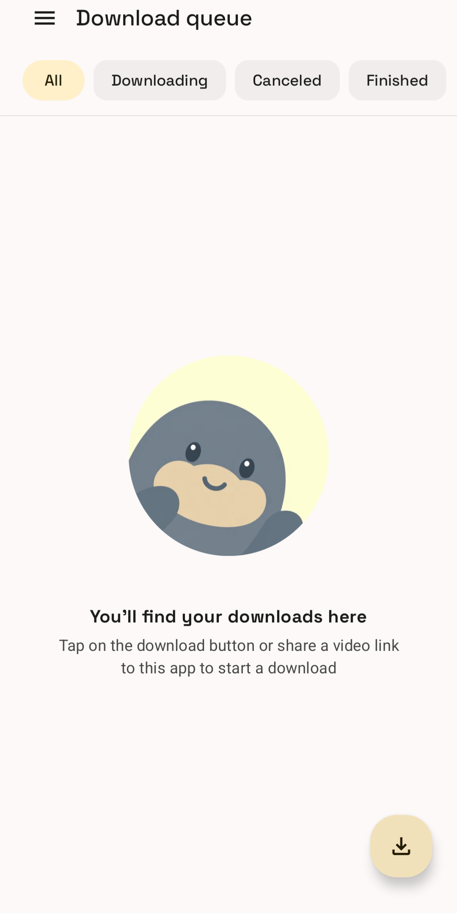
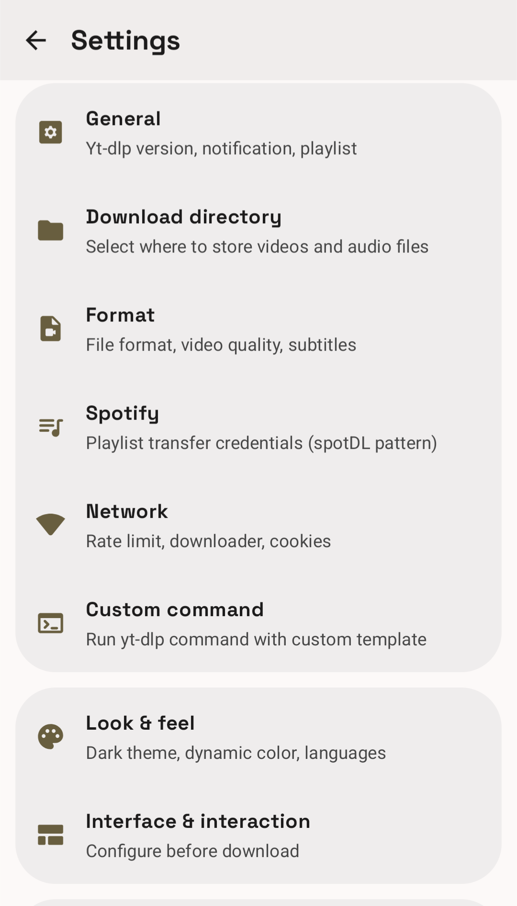
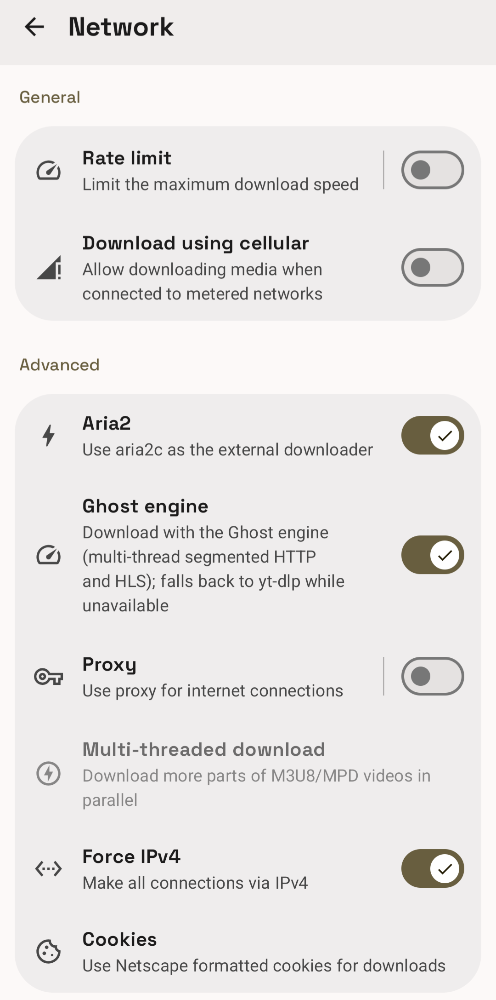

<div align="center">


# Sleeve

**Paste a link. Pick a format. Get the file.**

**What is Sleeve?** A free, open-source (GPL-3.0) video and audio downloader
for Android 7.0+ with no ads, tracking, or accounts. It supports YouTube,
Instagram, TikTok, Twitter/X, Reddit and 1,800+ yt-dlp sites, 500+ gallery-dl
image hosts, HLS/DASH streams, Spotify playlists and Audible audiobooks, and
downloads each link by the fastest path available.

[](https://github.com/Burry071/sleeve/releases/latest)
[](https://github.com/Burry071/sleeve/releases)
[](LICENSE)
[](https://github.com/Burry071/sleeve/actions/workflows/ci.yml)
[](https://developer.android.com)

[](https://rookieenough.github.io/Orion-Data/app/?id=sleeve)
[](https://apps.obtainium.imranr.dev/redirect?r=obtainium://app/%7B%22id%22%3A%22com.sleeve.app%22%2C%22url%22%3A%22https%3A%2F%2Fgithub.com%2FBurry071%2Fsleeve%22%2C%22author%22%3A%22Burry071%22%2C%22name%22%3A%22Sleeve%22%7D)

&nbsp;&nbsp;

</div>

Sleeve is a community fork of [Seal](https://github.com/JunkFood02/Seal)
(GPL-3.0). It combines yt-dlp and gallery-dl extraction with a built-in
multi-connection download engine based on
[Ghost Downloader](https://github.com/XiaoYouChR/Ghost-Downloader-3), so a
resolved link is downloaded by the fastest path available instead of one
single-threaded HTTP stream.

## What it does

- **1,800+ sites** through yt-dlp: YouTube, Vimeo, TikTok, Twitter/X,
  SoundCloud, and everything on the
  [supported sites list](https://github.com/yt-dlp/yt-dlp/blob/master/supportedsites.md)
- **Instagram, Reddit, Imgur, Pixiv and 500+ image hosts** through embedded
  gallery-dl, with anonymous resolution for most Reddit and Instagram posts
- **Multi-connection downloads**: 8 parallel connections per file with resume,
  for direct file links
- **HLS and DASH streams** (m3u8/mpd) through bundled N_m3u8DL-RE, including
  AES-128
- **Spotify playlists and Audible audiobooks**: public metadata is resolved
  and the best-matching audio is downloaded from YouTube (spotDL method)
- **Full format control**: resolution, audio-only, subtitles, SponsorBlock,
  metadata embedding, filename templates
- **Material 3 Expressive UI** with dynamic color, light and dark themes

## Quick start

1. Install the APK (below) and open Sleeve once.
2. Share any video or image link to Sleeve from another app, or copy the
   link and tap the clipboard card in the app.
3. Choose a format or just hit Download. Files land in `Download/Sleeve/`.

## Supported sources

| Content | How it is downloaded |
| --- | --- |
| Video and audio sites (YouTube, Vimeo, TikTok, …) | yt-dlp extraction, native Android clients |
| Direct file links (CDN, mp4, mp3, zip, …) | Ghost engine, segmented HTTP with resume |
| Live and on-demand HLS/DASH (m3u8, mpd) | N_m3u8DL-RE, multi-threaded segments |
| Image hosts and galleries (Instagram, Reddit, Pixiv, Imgur, …) | gallery-dl |
| Pages without a dedicated extractor | generic media sniffing (og:video, stream URLs) |
| Spotify playlists, albums, and tracks | public metadata, ranked YouTube match, audio |
| Audible audiobooks | public catalog metadata, ranked YouTube match |

Content protected by DRM (Netflix, Disney+, Widevine streams) is not
supported, by design.

## Privacy and safety

Sleeve collects nothing: no telemetry, no analytics, no accounts. Everything
runs on your device. Download URLs are validated before any request leaves
the app.

Only install APKs signed with the release certificate `CN=Sleeve, O=Burry071`
from this repository's Releases or the Orion Store listing. APKs from
third-party mirrors are not checked by anyone.

## Download

[](https://github.com/Burry071/sleeve/releases/latest/download/Sleeve-arm64-release.apk)

Direct, signed APK for most phones (arm64-v8a, Android 7.0+). The button always
serves the current release, so there is no need to open the releases page
first. Release notes and older versions are on the
[releases page](https://github.com/Burry071/sleeve/releases).

Each release ships three APKs; pick the one that matches your device:

| Device | File |
| --- | --- |
| Most phones (arm64-v8a) | [`Sleeve-arm64-release.apk`](https://github.com/Burry071/sleeve/releases/latest/download/Sleeve-arm64-release.apk) — the default download |
| x86_64 devices and emulators | [`Sleeve-x86_64-release.apk`](https://github.com/Burry071/sleeve/releases/latest/download/Sleeve-x86_64-release.apk) |
| Either of the above | [`Sleeve-generic-release.apk`](https://github.com/Burry071/sleeve/releases/latest/download/Sleeve-generic-release.apk) (arm64-v8a + x86_64, larger) |

All three carry the same versionCode and the same signing certificate, so
switching between them or updating from one to another is never treated as a
downgrade.

Also available on the
[Orion Store](https://rookieenough.github.io/Orion-Data/app/?id=sleeve).

## Verify the APK you downloaded

Releases are signed with the project certificate `CN=Sleeve, O=Burry071`. To
check that a file is the APK this repository published and not a
re-packed copy:

```bash
apk=Sleeve-arm64-release.apk
sha256sum "$apk"
# compare the digest with the matching line in SHA256SUMS from the same release

apksigner verify --print-certs "$apk"
# Signer #1 certificate DN: CN=Sleeve, O=Burry071
# Signer #1 certificate SHA-256 digest:
# 2d5fd54b83c2b24d5fc267b8d082c936c44fd113db4267eb1c2f573a36adcad3
```

On Windows, `Get-FileHash $apk -Algorithm SHA256` produces the same hash. The
APK hash changes with every release, so compare it against the `SHA256SUMS`
asset attached to that release. The certificate digest must never change.

The repository also carries a read-only verifier that checks the release
asset, its size and SHA-256, the Orion mirror entry, the package name, the
version code and the signer, and can download the APK in one step:

```bash
python scripts/verify_release.py --channel beta --download ./apk-out
```

See `python scripts/verify_release.py --help` for the pinning options
(`--expect-tag`, `--expect-sha256`, `--expect-version-code`, `--expect-cert`,
`--abi arm64-v8a` or `--abi x86_64` to pick a specific artifact).
Package and signer checks use `aapt`/`apksigner` from `ANDROID_HOME` or
`ANDROID_SDK_ROOT` build-tools, or from `PATH`; when a tool is missing, or
`apksigner` cannot start because no JDK is configured, the verifier reports a
warning that says the check was skipped instead of passing it.

## FAQ

**Is Sleeve free?**
Yes. GPL-3.0 software with no paid tiers, no ads, and no subscriptions.

**Does Sleeve work with YouTube?**
Yes. YouTube downloads use yt-dlp with native Android player clients, which
avoids the JavaScript-runtime requirement that breaks most Android YouTube
downloaders.

**Can Sleeve download a Spotify playlist as MP3?**
Yes. Sleeve reads the public playlist metadata from Spotify, ranks the
matching YouTube audio tracks (title, artist, duration, live/remix
penalties), and downloads the best match. Match strictness is configurable in
Settings.

**Why does an Instagram or Reddit post fail with a login message?**
Some sites and subreddits require an authenticated session. Log in once via
Settings → Cookies & profiles; Sleeve reuses that session for later
downloads. Most public Reddit posts and Instagram reels work without it.

**How is Sleeve different from Seal?**
Sleeve keeps every Seal feature and adds a multi-connection engine, HLS/DASH
support, gallery-dl coverage, Spotify and Audible matching, and anonymous
Reddit resolution. See [Sleeve vs Seal](#sleeve-vs-seal) for the full table.

**Which sites are supported?**
Anything listed by
[yt-dlp](https://github.com/yt-dlp/yt-dlp/blob/master/supportedsites.md) and
[gallery-dl](https://github.com/mikf/gallery-dl/blob/master/docs/supportedsites.md),
plus direct file links and most pages containing a video stream.

## Sleeve vs Seal

Sleeve is a [Seal](https://github.com/JunkFood02/Seal) fork (GPL-3.0) that keeps
every original feature and adds the capabilities below. Comparison is against
Seal 1.13.1.

| Capability | Sleeve | Seal |
| --- | --- | --- |
| yt-dlp extraction, SponsorBlock, subtitles, cookies, custom commands | Yes | Yes |
| Multi-connection download engine (8 connections, resume) | Yes, Ghost | No |
| HLS/DASH via N_m3u8DL-RE, including AES-128 | Yes | No |
| gallery-dl image and gallery coverage (500+ hosts) | Yes | No |
| Spotify playlist and Audible audiobook matching | Yes | No |
| Anonymous Reddit resolution | Yes | No |
| Material 3 Expressive interface | Yes | No |

Both are GPL-3.0 and run entirely on device.

## Build

Requirements: JDK 21, Android SDK, and Python 3.13 for the Chaquopy build
step.

```bash
./gradlew :app:assembleGenericDebug -PnoSplits -PABI_FILTERS="arm64-v8a;x86_64"
```

Release builds are signed when `keystore.properties` exists at the repo root.
See [SIGNING.md](SIGNING.md). CI builds every push and publishes signed APKs
for tagged releases.

## Contributing

Bug reports and feature requests go to the
[issue tracker](https://github.com/Burry071/sleeve/issues). Pull requests are
welcome; keep them focused on one change per PR.

## Credits and license

Sleeve is GPL-3.0, as are Seal and Ghost Downloader. N_m3u8DL-RE is MIT.
See [THIRD_PARTY.md](THIRD_PARTY.md) for the complete list of bundled
components and licenses. Sleeve is an independent project and is not endorsed
by Seal, Ghost Downloader, yt-dlp, or gallery-dl.
