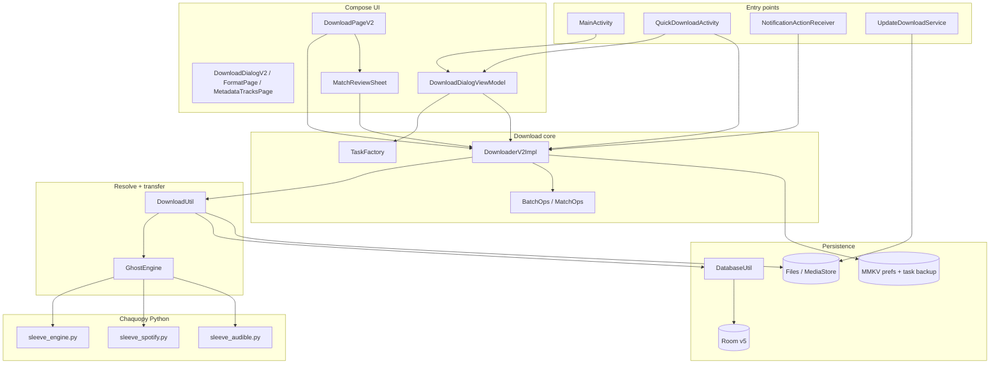
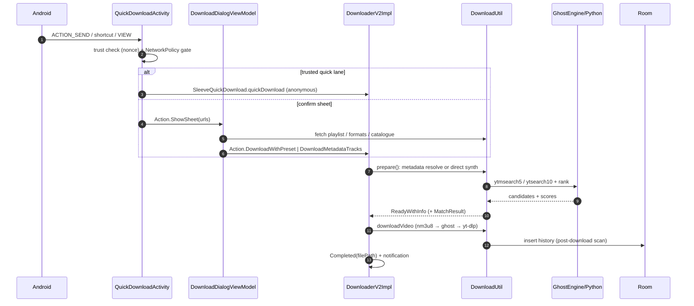
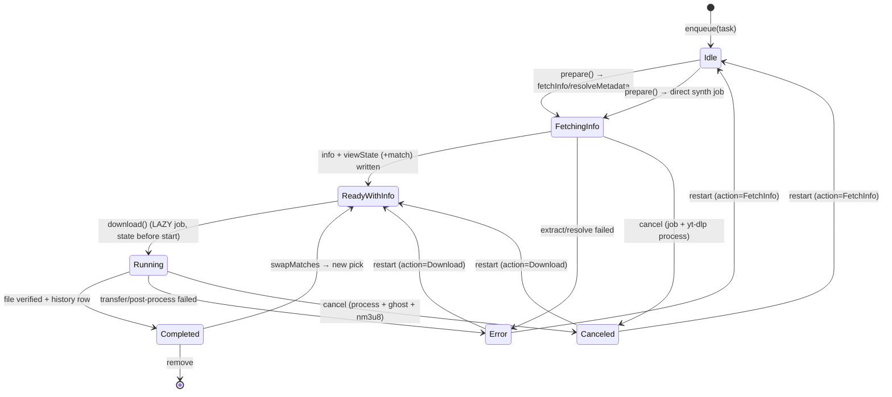
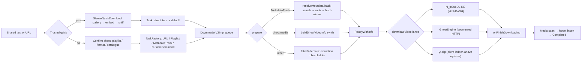
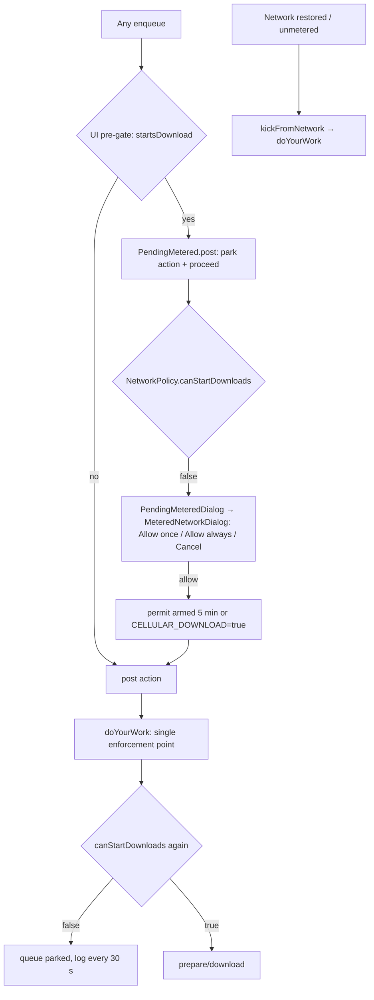

# Sleeve code graph

A navigation map, not an API reference. Read this before opening Kotlin files; open a file only when the map says the answer lives there.

- **Repo state:** `main` at `6dfa2f72` — beta.4, Audible phase 1–2, and the state-machine landing PRs #33–#37 are all merged. The test counts in §10 were produced on this tree on 2026-11-12.
- **Not in this map:** generated code, drawable vectors, translations (60+ locale folders), release scripts.
- **Machine-readable twin:** [`docs/code-graph.json`](code-graph.json) — nodes carry `path`/`role`/`layer`/`symbols`, edges carry `relation`. Load it instead of grepping.

### Phase 1 Audible delta (2026-11-11)

The beta.4 map above is still correct for the download core. Phase 1 adds four things to read first:

| Component | Path | What changed |
|---|---|---|
| Audible gate | `app/src/main/python/sleeve_audible_gate.py` | Pure `gate_audible`: title F1, duration tolerance, junk veto, language declaration; `pass` is the only verdict that may download. |
| Audio verification | `app/src/main/java/com/junkfood/seal/util/AudioVerify.kt` | Reads the finished file's duration; mismatch becomes `Completed.warning`, never a silent success. |
| Held state | `MatchResult.held/expectedDurationMs/gateReason/actualDurationMs` + `MatchOps.reviewable` | A hold is a `Canceled` task with a review entry; `resolvedState` never writes `ReadyWithInfo`. |
| Paste-link override | `MatchReviewSheet` | A single held book can accept a user-pasted YouTube URL; it goes through the normal swap/fetch path. |

Flow: `resolveMetadataTrack` ranks up to 10 for Audible → gate pass = `ReadyWithInfo`; hold/no-match = `Canceled` + held match (zero media bytes) → review sheet → explicit candidate or pasted URL → `swapOne` → download → `AudioVerify` before `cleanupSwappedFile` deletes anything. The old file/row survive a failed replacement.

Do **not** treat `MatchResult.selected` as authoritative when `selectedUrl` is blank (a hold); the sheet intentionally starts with no radio selected.

### Audible phase 2 delta (2026-11-11)

Phase 2 closes the ranker→gate join and the hold lifecycle. Read `docs/reviews/AUDIBLE-PHASE2-FINAL.md` for the verdict table before touching this path.

| Component | Path | What changed |
|---|---|---|
| Match phase | `Match.kt` (`MatchPhase`) | A pending swap wins the phase, then `Held`, then `NeedsReview`; `held` stays readable through `withSelection`/`cancelPending`. |
| Ranker join | `DownloadUtil.resolveMetadataTrack` | A `split` verdict from the gate is what turns a part set into multiple tasks; the ranker alone never splits. |
| Narrator/edition gate | `sleeve_audible_gate.py` | Known narrator/edition mismatches hold with a reason instead of guessing. |
| Hold override | `DownloaderV2.swapOne` | A picked candidate is the only way out of a hold, and only `confirmSelection` clears `held`. A failed pick restores the hold. |
| Part labels | `MatchOps`, `MatchReviewSheet` | Part labels render one-based for both `Part N` and `N of M` bases. |
| Tests | `MatchGateTest`, `AudiblePartsTest`, `AudibleLanguagePlumbingTest`, `MatchSplitCopyTest` | Hold lifecycle, part parsing, language plumbing, sheet copy. |

**Known regression, still open (verified 2026-11-12):** `_LONG_FORM_PART_RE` in `sleeve_spotify.py` treats `11/22/63` as a part marker — `_strip_long_form_decor('11/22/63 | Full Audiobook')` returns `'/63'`, so the name score falls below the long-form floor and the book ends in `Error: No confident YouTube match` with no picker. A green ranker suite does not cover slash-numbered titles. See `docs/reviews/AUDIBLE-PHASE2-FINAL.md` §2.1.

### State-machine landing delta (2026-11-12)

The 11-commit pile that shipped as PRs #33–#37 made the implicit machines explicit. Nothing serialized changed: `Task`, `DownloadState`, `MatchResult` and `DownloadPreferences` still decode a beta.4 MMKV backup.

| Component | Path | What changed |
|---|---|---|
| Legal edges | `download/TaskTransitions.kt` | Pure `isLegal` table plus `restore`, `enqueueReplaces`, `restartTarget`, `cancelTarget`. `applyTransition` refuses and logs an edge outside the table. |
| Meter holder | `ui/page/downloadv2/configure/PendingMetered.kt` | One parked action + one renderer for all three hosts (`DownloadPageV2`, `QuickDownloadActivity`, `TaskListPage`). `post()` parks only when the action starts a download on a metered network. |
| One screen | `ui/page/downloadv2/configure/DialogScreen.kt` | Sheet/format/playlist/metadata derived from all three flows at once; a selection outranks a stale sheet, `Hidden` outranks a stale `SheetState`. |
| Command log | `download/TaskOutputLog.kt` | Bounded per-task command output (2000 lines / 200 tasks), kept apart from `TaskAuditLog` so state evidence is not pushed out by noisy commands. |
| V2 task views | `ui/page/command/TaskListPage.kt`, `TaskLogPage.kt` | These render the one queue state; the legacy `HomePageViewModel` command machine and its screens are deleted. |
| Updater claim | `util/AppUpdateManager.kt` | One `transferClaimed` CAS guards the APK transfer; a second Start never spawns a second download. |
| Queue hygiene | `DownloaderV2` enqueue/cancel paths | `enqueueReplaces`, retry rung and cancel target come from `TaskTransitions` instead of `else ->` branches. |

## 0. How to spend the fewest tokens

| Question | Go here | Do not read |
|---|---|---|
| Why did a task stay queued? | [§6](#6-network-policy-the-metered-gate), then `NetworkPolicy.kt` | whole `DownloaderV2.kt` |
| Which lane downloaded this file? | [§4](#4-data-flow-share--resolve--queue--download--history) lane table | `DownloadUtil.kt` (2.1k lines) |
| Why is this song "Reached review"? | [§5](#5-match--review--swap), then `MatchOps.kt` (33 lines) | the Python ranker |
| Where do I add a setting? | [§9](#9-where-to-change-x) | the 60 locale folders |
| What changed in beta.4? | [§11](#11-beta4-changes-landed) + `git show` | `docs/.beta4-review-diff.txt` (122 KB local snapshot) |
| What must never break? | [§8](#8-invariants--gotchas) | — |

Anchor convention below: `path:symbol` rather than line numbers, because the beta.4 tree is still moving.

## 1. Layers



| Layer | Owns | Never reaches into |
|---|---|---|
| Entry (`MainActivity`, `QuickDownloadActivity`, receivers) | intent parsing, nonce trust, overlay lifetime, service start/stop | download state transitions |
| UI (`ui/page/downloadv2/**`, `configure/**`) | rendering `SnapshotStateMap<Task, Task.State>`, user actions | yt-dlp/Chaquopy |
| Downloader (`download/**`) | queue, concurrency, state transitions, notifications, swap lifecycle | Compose |
| Resolve/transfer (`DownloadUtil`, `GhostEngine`) | command building, extraction ladder, engine handoff, history insert | UI state |
| Python | catalogue resolve, ranking, HTTP transfer, gallery/sniff | Kotlin types (JSON strings only) |
| Data | Room (history/templates/cookies/shortcuts), MMKV (prefs + task backup) | — |

## 2. Entry points

| Surface | Declared in | Handler | First hop |
|---|---|---|---|
| Launcher | `AndroidManifest.xml` `MainActivity` (`singleTask`) | `MainActivity.handleIntent` | `Action.ShowSheet` or `openMatchReview` |
| `VIEW http/https`, `video/*`, `audio/*` | `MainActivity`, `QuickDownloadActivity` | `handleIntent` / `getSharedURL` | sheet pre-filled |
| `SEND` / `SEND_MULTIPLE text/plain` | **only** `QuickDownloadActivity` | `getSharedURL` → `matchUrlFromSharedText` | quick lane or sheet |
| Share-sheet "Quick download" (nonce) | `QuickDownloadActivity` (`singleInstance`) | `isTrustedQuick()` | `SleeveQuickDownload.quickDownload` |
| Launcher shortcuts | `App.publishQuickDownloadShortcut` (dynamic, 2 shortcuts) | `EXTRA_QUICK_DOWNLOAD` + nonce | quick lane; clipboard shortcut reads clipboard on focus |
| Task notification (Cancel / Copy report) | `NotificationUtil` → `NotificationActionReceiver` | `downloader.cancel(taskId)` | queue |
| Batch review notification | `NotificationUtil.notifyBatchReview` (`EXTRA_REVIEW_BATCH_ID`) | `MainActivity.handleIntent` | `openMatchReview(batchId)` |
| Update notification (Install / Cancel) | `NotificationUtil` → `NotificationActionReceiver` | `AppUpdateManager.install/cancelDownload` | package installer |
| Foreground service | `DownloadService`, `UpdateDownloadService` | started + bound | keeps process alive |



Note: `MainActivity` still contains an `ACTION_SEND` branch, but no manifest filter declares it — real shares land in `QuickDownloadActivity`. Treat the branch as defensive, not as a second path.

## 3. Task state machine

`Task.DownloadState` (`download/Task.kt`) is the only queue state. It is `@Serializable` and backed up to MMKV.



| Transition | Trigger | Guard / side effect |
|---|---|---|
| `Idle → FetchingInfo` | `doYourWork` picks by `schedulerRank` | `if (downloadState != Idle) return` — stale pick no-ops |
| `FetchingInfo → ReadyWithInfo` | worker success | late result dropped if state changed (cancel wins) |
| `ReadyWithInfo → Running` | `DownloaderV2Impl.download` | `LAZY` job then state write; prevents a second `downloadVideo` |
| `Running → Completed` | `onSuccess(path)` | `enrichWithCompletedFile` then `cleanupSwappedFile` |
| `Running → Error` | `onFailure` | `abandonSwappedFile` first; `Error.message` is user-facing |
| any cancelable → `Canceled` | `cancelImpl` | kills yt-dlp/ghost/nm3u8; keeps `Completed` if the worker won the race |
| `Canceled/Error → Ready/Idle` | `restartImpl` | action decides the rung |
| `Canceled/Error/Idle → ReadyWithInfo` | `swapOne` | an explicit pick is the one way out of a hold; the busy guard re-checks the starting state |

Scheduler facts (`DownloaderV2Impl.doYourWork`):
- `MAX_CONCURRENCY = 3`; counting covers `Running` + `FetchingInfo`.
- Pick order is `sortedBy { schedulerRank }` (`ReadyWithInfo=0`, `Idle=1`, everything else 2), then the first `ReadyWithInfo` or `Idle`. Card order uses the separate `displayRank` (`Running=0 … Completed=6`).
- Every state write goes through `applyTransition`, which checks `TaskTransitions.isLegal` under one lock; an illegal or stale edge is refused and logged instead of overwriting a terminal state.
- `TaskTransitions.restore(from)` runs when a backup is loaded: `Idle`/`FetchingInfo` become `Canceled(FetchInfo)` and `Running` becomes `Canceled(Download, progress)`, while terminal states pass through untouched. **Restore-as-Canceled is deliberate** — a killed process cannot resume yt-dlp, so a restored row must offer retry rather than pretend to still be running.
- `enqueueReplaces`, `restartTarget` and `cancelTarget` replaced the old `else ->` decisions. Custom commands restart through `Idle`, not `ReadyWithInfo`.
- Auto-continue after a restore is intentionally not an edge in the table (issue #31): the user resumes, the app does not.
- The scheduler is driven by `snapshotFlow { taskStateMap.toMap() }`; `Snapshot.sendApplyNotifications()` is required after writes made with no UI attached (share with app closed).
- `App.startService()` / `stopService()` follow the running count. `DownloadService` distinguishes started vs bound lifetime; a `START_STICKY` restart with a null intent stops itself.

## 4. Data flow: share → resolve → queue → download → history



Lane selection inside `DownloadUtil.downloadVideo` — ordered, first eligible wins:

| # | Lane | Eligible when | Falls through when |
|---|---|---|---|
| 0 | direct synthesis (`buildDirectVideoInfo`) | `galleryDirect`, or a bare direct-media URL that is not an audio-extraction request (images always qualify) | — it *is* the info |
| 1 | `N_m3u8DL-RE` (`runNm3u8DlReIfEligible`) | segmented HLS/DASH manifest + bundled ELF runnable | not eligible → next |
| 2 | Ghost engine (`runGhostDownloadIfEligible`) | single progressive format, no post-processing, no audio extraction, `aria2c` off, `cookies` off, safe non-manifest URL, engine enabled | engine declines, unsafe URL, or transfer fails → yt-dlp |
| 3 | yt-dlp (`downloadClientLadder`) | always the floor | — |

yt-dlp-specific rules:
- Extraction ladder for YouTube: `android_vr,android,ios` → `tv` → yt-dlp default. The winning client string is cached in `successfulExtractionClients[taskKey]` and reused for the download attempt.
- Download ladder: cached client → yt-dlp default → `tv`.
- `aria2c` is optional; one failure containing "aria2c" retries once with `aria2c=false`. **Aria2 takes precedence over Ghost**: the Ghost eligibility check bails on `aria2c` (and on cookies/rate limit/subtitles/post-processing), which is what `aria2_over_ghost` tells the user.
- History is written by `onFinishDownloading` from files modified after the download started (`scanFileToMediaLibraryPostDownload`), not by title matching. `privateMode` skips the insert; an empty path list is a failure, not a success.

## 5. Match / review / swap

```mermaid
sequenceDiagram
  autonumber
  participant DL as DownloaderV2Impl
  participant DU as DownloadUtil
  participant PY as sleeve_spotify.rank_candidates
  participant UI as PlaylistBatchCard
  participant RS as MatchReviewSheet
  DL->>DU: resolveMetadataTrack(track)
  DU->>DU: buildMetadataQuery (Audible: quoted title + authors)
  DU->>PY: rank ytmsearch5
  PY-->>DU: scores + reasons (+ long-form veto)
  alt top score below 60
    DU->>PY: rank ytsearch10 (widen)
  end
  DU->>DU: matchBestCandidates → top 3
  DU->>DU: MatchOps.isLowConfidence → flagged?
  DU-->>DL: MetadataResolution(videoInfo, MatchResult)
  DL->>UI: ReadyWithInfo; badge when reviewable
  UI->>RS: review entry only when batch unfinished == 0
  RS->>DL: swapMatches(selections)
  DL->>DU: fetchVideoInfoFromUrl(candidate) — no new search
  DL->>DL: match.withSelection → pending=true
  DL->>DL: download → cleanupSwappedFile: verify file, delete old row+file, confirmSelection
```

Scoring contract (`sleeve_spotify.rank_candidates`):

| Component | Weight (music / long-form / strict) | Floor / rule |
|---|---|---|
| name | 0.40 / 0.55 / 0.35 | floor 50/60/75 by strictness; long-form strips "Full Audiobook", "Book One", separators |
| artist | 0.35 / 0.15 / 0.45 | floor 0/40/60; `- Topic` +10, VEVO +10, junk channel −20 |
| duration | 0.25 / 0.30 / 0.20 | bands 100/90/75/50/25; unknown → 55 |
| long-form veto | — | candidate < 25 % of book runtime is rejected outright |

- `MatchOps.FLAG_TOP_RATIO = 0.75`, `FLAG_GAP_RATIO = 0.15`: flagged when top < 75 or gap < 15.
- Review entry visibility: `BatchOps.summary(entries).unfinished == 0 && reviewCount > 0` (`MatchOps.reviewVisible`). One entry per batch, also mirrored as a notification.
- A swap never re-runs a search. It re-fetches the chosen URL, parks the old path in `pendingSwapCleanup`, and marks `pending=true`. Only a verified non-empty replacement promotes the pick and deletes the old row+file.

## 6. Network policy (the metered gate)



`NetworkPolicy.permits(cellularAllowed, metered, permitArmed) = cellularAllowed || !metered || permitArmed`.

- Fail-open by contract: no `ConnectivityManager` → unmetered; `canStartDownloads` never throws.
- The permit is **time-boxed, not consumed** (`PERMIT_WINDOW_MS = 5 min`, `elapsedRealtime`) so a batch the user just approved is not stranded after song one.
- Unmetered callback clears the permit; a later metered switch must not inherit it.
- A network restore must call `doYourWork()` directly — `snapshotFlow` only re-emits on a map change.
- The three hosts — `DownloadPageV2`, `QuickDownloadActivity` and `TaskListPage` (command lane) — all park through one holder, `PendingMetered.post(action, proceed)`, which asks only `Action.startsDownload()`. `PendingMeteredDialog` is the only renderer, so no lane can start past a parked gate silently. Do not add a fourth private pre-gate.
- Dialog copy says "metered network" because the gate also fires on metered Wi-Fi; the string key keeps its historical name (`download_with_cellular_request`) for existing translations.

## 7. File ownership map

| Area | Owner file(s) | Rule of thumb |
|---|---|---|
| Queue truth | `download/Task.kt`, `download/DownloaderV2.kt` | every state write goes through `DownloaderV2Impl`'s private accessors; never mutate the map elsewhere |
| State edges | `download/TaskTransitions.kt` | pure table + the decisions that used to be `else ->`; a new edge is added here and tested, never inline |
| Metered holder | `ui/page/downloadv2/configure/PendingMetered.kt` | the only parked-action holder and the only metered renderer for all hosts |
| Command output | `download/TaskOutputLog.kt` | bounded, in-memory, separate from `TaskAuditLog`; the log page reads it, nothing else writes |
| Batch math | `download/BatchOps.kt` | pure functions over `Map<Task, Task.State>`; safe to unit test |
| Match rules | `download/MatchOps.kt`, `download/Match.kt` | thresholds and pending transitions live here, not in UI |
| yt-dlp commands | `util/DownloadUtil.kt` | one file owns options, lanes, history insert |
| Python bridge | `ghostengine/GhostEngine.kt` | the only place `Python.getInstance()` is called |
| Ranking | `app/src/main/python/sleeve_spotify.py` | pure scoring + JSON contract |
| Catalogue metadata | `sleeve_audible.py` (Audible public API), `sleeve_spotify.py` `resolve` | metadata only; audio always comes from the yt-dlp/ghost lane |
| Preferences | `util/PreferenceUtil.kt` (+ `DownloadPreferences` in `DownloadUtil`) | one MMKV key const per setting; add to `createFromPreferences` **and** `EMPTY` |
| Notifications | `util/NotificationUtil.kt` | channel + PendingIntent identity; `notificationId = id.hashCode()` / `batch.id.hashCode()` |
| History | `util/DatabaseUtil.kt`, `database/**` | Room v5 is frozen; `deleteInfoByPath` pairs with file deletion |
| Quick lane fence | `util/QuickDownloadPolicy.kt`, `util/SleeveQuickDownload.kt` | `withoutCookies()` is the single session gate |
| Update | `util/AppUpdateManager.kt`, `util/UpdateVerifier.kt`, `UpdateDownloadService.kt` | one `transferClaimed` CAS owns the transfer; digests + signer check before install |
| Strings | `app/src/main/res/values/strings.xml` | 506 keys; other locales are translation-only |

## 8. Invariants & gotchas

1. **Task id is frozen at construction.** `Task.id = makeId(url, type, preferences.hashCode())`; `copy(preferences=…)` (e.g. `TaskFactory.stampBatch`, `dismissBatch`'s `copy(batch=null)`) does **not** recompute it. Ids are used for the yt-dlp process key, `TaskAuditLog`, and `notificationId` — not for equality. Do not "fix" an id by hand.
2. **Batch key is a fresh UUID per submission** (`DownloadDialogViewModel`, `UUID.randomUUID()`). It is the notification id and the review key. Equal tracks in two submissions produce different `Task.id`s (synthetic `metadata://provider/batch/pos` URL) but `Task.isSameWork` still recognises the duplicate.
3. **Compose list key is `uiKey = "$id#${batch?.id}"`.** Ids can repeat across batches of the same playlist; `id` alone is not a safe LazyColumn key.
4. **Pending swap is a two-phase commit.** `withSelection` parks `previousSelectedUrl` and sets `pending=true`; only a non-empty verified file calls `confirmSelection`; a fetch failure calls `cancelPending`. `acknowledgeMatches` deliberately skips pending picks. `pendingSwapCleanup` is **in-memory only**.
5. **Cancel does not clear `pending`.** `cancelImpl` stops the worker but never touches `match`; `abandonSwappedFile` runs only in the download failure branch. A cancelled swap therefore keeps "Replacing…" and disables that row's radios until a retry succeeds. Also, after process death the parked old path is gone, so a successful retry promotes the new pick but cannot delete the replaced file/history row.
6. **Terminal truth is the return value.** `GhostEngine.watch(taskId)` returns the terminal snapshot for *that* task; `progressFlow` is a UI mirror. Reading the shared flow after `await()` used to attribute a newer task's snapshot to this one. After `MAX_POLL_RETRIES` unreadable polls it returns an `ERROR` snapshot carrying the same `taskId`, never `null`.
7. **A cancel racing a finish keeps `Completed`.** `cancelImpl` only writes `Canceled` when `killed || downloadState == preState`.
8. **Metered gate has one enforcement point** (`doYourWork`) plus one parked-action holder (`PendingMetered`, shared by the three hosts). A new enqueue path must park through the holder; a permit is a 5-minute window, not a token.
9. **Batch songs have no per-task notification** (`usesOwnNotification = batch == null`). Progress goes through the one batch notification; review replaces it when the batch is done.
10. **`DownloadPreferences` is part of identity.** Adding a field means: default in `EMPTY`, read in `createFromPreferences`, and a default that keeps old MMKV/Room backups decodable (`galleryDirect`, `referer` are the precedent).
11. **Room is v5 with four auto-migrations.** No schema change is in scope for beta.4; history fixes go through DAO methods (`insertInfoDistinctByPath`, `deleteInfoByPath`).
12. **Quick mode is a fence, not a login.** `withoutCookies()` clears the `cookies` flag; the quick lane only builds plain URL tasks, so no template `--config-locations` can reach it. Share actions always fall back to the sheet even with the extra present.
13. **The direct lane strips thumbnail flags.** yt-dlp's thumbnail postprocessor fails on a bare image; `downloadVideo` clears `createThumbnail`/`embedThumbnail` for direct items.
14. **Download completion is defined by files, not by exit code.** `onFinishDownloading` fails the task when the post-download scan finds no file (except `privateMode`, which intentionally inserts nothing).

## 9. Where to change X

| Task | Touch (in order) | Tests to extend |
|---|---|---|
| **Add a site** (gallery/embed/sniff) | `sleeve_engine.py` `_GALLERY_SITES`/`gallery_matches` + `_SNIFF_RES` → `GhostEngine.galleryMatches/sniffMedia` → `SleeveQuickDownload.enqueue` fallback order → `DirectMediaRules` if the CDN URL ends in a media extension | `DirectMediaRulesTest`; add a Python case beside `scripts/test_match_rank.py` (new `scripts/test_gallery.py`) |
| **Add a setting** | `PreferenceUtil` key const → `DownloadUtil.DownloadPreferences` field + `createFromPreferences` + `EMPTY` → consume it in `DownloadUtil` → settings page (`ui/page/settings/**`) → `strings.xml` | `QuickDownloadPolicyTest` (if it touches the cookie/session surface), `MetadataTaskFactoryTest` (preferences defaults) |
| **Change matching** | `sleeve_spotify.py` `_name_score/_artist_score/_duration_score/rank_candidates` → thresholds in `DownloadUtil` (`WIDEN_BELOW_SCORE`) and `MatchOps` (`FLAG_*`) → `MatchReviewSheet` labels | `scripts/test_match_rank.py`, `MetadataMatchingTest`, `BatchMatchInvariantTest`, `CandidateMappingTest` |
| **Change queue state** | `Task.DownloadState` (+ `ordinal`) → `DownloaderV2Impl` transitions/setters → `BatchOps` predicates → `VideoCardV2`/`PlaylistBatchCard` rendering → `enqueueFromBackup` decode | `TaskRemovalTest`, `BatchOpsTest`, `FilterPredictTest`, `BatchModelTest` (backup round-trip) |
| **Add a string** | `res/values/strings.xml` only; use `stringResource(R.string.x)` | none (lint only); translations arrive separately |
| **Add a test** | Kotlin: `app/src/test/java/com/junkfood/seal/<Area>Test.kt`, JUnit4, pure functions preferred (`BatchOps`, `MatchOps`, `NetworkPolicy`) | run `./gradlew :app:testGenericDebugUnitTest` |
| **Add a download lane** | `DownloadUtil.downloadVideo` (insert before yt-dlp) → `cancelImpl` must learn its cancel call → progress callback contract `(Float, Long, String)` | `DirectVideoInfoTest`, a new pure test for eligibility |
| **Change batch behaviour** | `BatchOps` (pure) → `DownloaderV2.cancelBatch/resumeBatch/dismissBatch` → `PlaylistBatchCard` → `NotificationUtil.notifyBatch*` | `BatchOpsTest`, `BatchDismissPlanTest`, `BatchMatchInvariantTest` |

## 10. Test map

| Suite | Count | Covers |
|---|---|---|
| `TaskTransitionsTest` | 20 | legal-edge table, restore-as-Canceled, restart rungs, enqueue replacement, late-writer races |
| `QuickDownloadPolicyTest` | 15 | nonce trust, cookie fence, "one producer" invariants for cookies/templates |
| `MetadataMatchingTest` | 14 | query building (Audible vs Spotify), widen-on-low-score, cancel between legs |
| `MatchGateTest` | 14 | hold lifecycle: ack cannot clear, pick only on confirm, failed override restores the hold, part labels, old JSON decodes as not held |
| `MatchTransactionTest` | 11 | `withSelection/confirm/cancelPending`, JSON round-trip, score/duration labels, `Error.message` |
| `MatchPhaseTest` | 10 | phase precedence (pending → held → needs-review) and held surviving a pending override |
| `RedditResolverTest`, `AudiblePartsTest` | 9 + 9 | Reddit post → media URL; Audible part parsing |
| `AppUpdateManagerTest` | 9 | ABI asset choice, channel/prerelease, digest, one-transfer claim |
| `MatchSplitCopyTest`, `FilterPredictTest`, `DirectMediaRulesTest` | 8 + 8 + 8 | split-card copy; filter prediction; direct-media extension sets |
| `BatchOpsTest`, `BatchModelTest`, `BatchMatchInvariantTest`, `BatchDismissPlanTest`, `AudioVerifyTest` | 7 × 5 | batch math/id/notification/back-compat; duration tolerance |
| `ResolveGateTest` | 6 | duplicate-resolve cooldown |
| `UrlExtractionTest`, `UpdateVerifierTest`, `TaskRemovalTest`, `NetworkPolicyTest`, `DownloadVerifyStateTest` | 5 × 5 | URL extraction; signer/digest; remove-vs-cancel; permit truth table; verify states |
| `TaskWorkIdentityTest`, `StagedSharePurgeTest`, `SdcardCopyResultTest`, `MetadataTaskFactoryTest`, `DialogScreenTest`, `CookieFileMigrationTest` | 4 × 6 | same-work dedupe; staging purge; SD copy; task factory; dialog precedence; cookie migration |
| `ResolveTaskKeysTest`, `GhostEngineWatchTest`, `DirectVideoInfoTest`, `CandidateMappingTest`, `AudibleLanguagePlumbingTest` | 3 × 5 | resolve keys; terminal-snapshot watch; direct info; candidate mapping; language plumbing |
| `FilterVisibilityTest`, `ExampleUnitTest`, `PlaylistStampTest` | 2 + 2 + 1 | filters; template; playlist stamping |
| **Kotlin total** | **245** | 37 result files, 0 failures (fresh run 2026-11-12) |
| `scripts/test_match_rank.py` | 15 | ranker: long-form veto, decoration stripping, floors, reasons |
| `scripts/test_audible_gate.py` | 53 | gate verdicts: title F1, duration tolerance, junk veto, narrator/edition, part parsing |
| `scripts/test_audible_resolve.py` | 6 | Audible catalogue resolve plumbing |
| `scripts/test_apk_gate.py` / `test_release_guard.py` / `test_verify_release.py` | 12 / 24 / 35 | release artifact gate, version guard, digest/signature |
| **Python total** | **145** | |

Commands (from repo root):

```bash
./gradlew :app:testGenericDebugUnitTest
python -m pytest scripts -q            # or: python -m unittest discover -s scripts -p "test_*.py"
./gradlew :app:assembleGenericDebug
python -m pytest scripts/test_match_rank.py -q
```

Status on 2026-11-12 (fresh, not reused): `:app:testGenericDebugUnitTest --rerun-tasks` → **245 tests in 37 result files, 0 failures, 0 errors, 0 skipped**; `python -m unittest discover -s scripts -p "test_*.py"` → **Ran 145 tests, OK**; `:app:assembleGenericDebug` → BUILD SUCCESSFUL (UP-TO-DATE: no source changed after the PR #37 build).

## 11. beta.4 changes (landed)

| Area | Change | Files | Guarded by |
|---|---|---|---|
| Swap lifecycle | `MatchResult.pending/previous*`, `confirmSelection`, `cancelPending`, `SwapResult`/`SwapOutcome`; sheet reports one line per song and stays open | `Match.kt`, `MatchReviewSheet.kt`, `DownloaderV2.kt` (swapOne/cleanup/abandon) | `MatchTransactionTest`, `BatchMatchInvariantTest` |
| Candidate metadata | uploader/channel/duration echoed from the ranker into `MatchCandidate`; `scoreLabel`/`durationText` | `sleeve_spotify.py`, `GhostEngine.kt`, `DownloadUtil.kt`, `Match.kt` | `CandidateMappingTest`, `test_match_rank.py` |
| Long-form ranking | strip audiobook decoration before name scoring; <25 % runtime veto stays | `sleeve_spotify.py` | `test_match_rank.py` |
| Ghost terminal truth | `watch()` returns the terminal snapshot; bounded retries; `unreadableSnapshot` | `GhostEngine.kt`, `DownloadUtil.kt` | `GhostEngineWatchTest` |
| Metered gate | `NetworkPolicy` + "Allow once" (5 min) / "Allow always"; single enforcement in `doYourWork`; UI pre-gates | `NetworkPolicy.kt` (new), `DownloaderV2.kt`, `DownloadPageV2.kt`, `QuickDownloadActivity.kt`, `MeteredNetworkDialog.kt` | `NetworkPolicyTest` |
| Service lifetime | started vs bound mode; `onDownloadServiceDestroyed`; quick overlay stops an idle badge | `App.kt`, `DownloadService.kt`, `QuickDownloadActivity.kt` | — (manual) |
| Queue errors | `Error.message` + friendly `SheetState.Error.message` | `Task.kt`, `DownloaderV2.kt`, `DownloadDialogViewModel.kt`, `DownloadPageV2.kt` | `MatchTransactionTest` |
| Update channel | stable refuses prereleases; debug build never installs | `AppUpdateManager.kt` | `AppUpdateManagerTest` |
| Settings polish | Spotify row copy moved into resources, drawer labels, part count on a dimmed row, "aria2 over ghost" note | `SettingsPage.kt`, `NavigationDrawer.kt`, `NetworkPreferences.kt`, `strings.xml` | — |
| History | `deleteInfoByPath` for swapped files | `DatabaseUtil.kt`, `VideoInfoDao.kt` | — |
| Batch card | review button/count, batch summary | `PlaylistBatchCard.kt`, `DownloadPageV2.kt` | `BatchMatchInvariantTest` |

New source paths landed with beta.4: `util/NetworkPolicy.kt`, `test/MatchTransactionTest.kt`, `test/ghostengine/GhostEngineWatchTest.kt`, `test/util/CandidateMappingTest.kt`, `test/util/NetworkPolicyTest.kt`. The review artifact `docs/.beta4-review-diff.txt` is a local snapshot and is not tracked.

## 12. Known gaps in this map

- The only instrumented test is the template `ExampleInstrumentedTest` (package name assertion); there are no Compose UI tests. `DialogScreenTest` and `PendingMetered` behaviour are tested as pure functions/state, not by rendering. Rendering is verified by previews and `assembleGenericDebug` only.
- `DownloadPage.kt` and the rest of `ui/page/download/**` are the legacy sheet; only `MeteredNetworkDialog` and `NotificationPermissionDialog` are still on live paths. Do not assume the rest is dead without checking imports.
- The legacy custom-command machine (`HomePageViewModel` and its screens) is deleted; `TaskListPage`/`TaskLogPage` render the one V2 queue. Do not reintroduce a second task-state holder.
- **Open ranker regression:** slash-numbered titles are misread as part markers (`11/22/63` → `/63`, verified 2026-11-12). See the phase-2 delta above; a fix needs its own test case in `scripts/test_match_rank.py`.
- Python gallery/sniff paths (`sleeve_engine.gallery_*`, `sniff_media`) have no unit tests; only the ranker, gate and release scripts do.
- Line-level anchors are omitted on purpose; use `rg -n '<symbol>' <path>` before editing.
